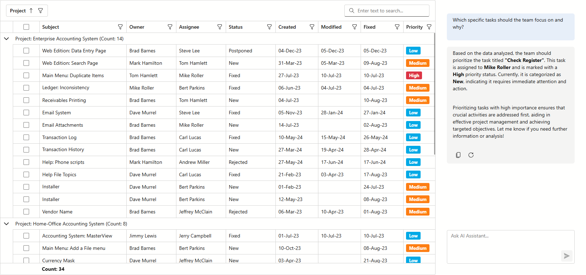
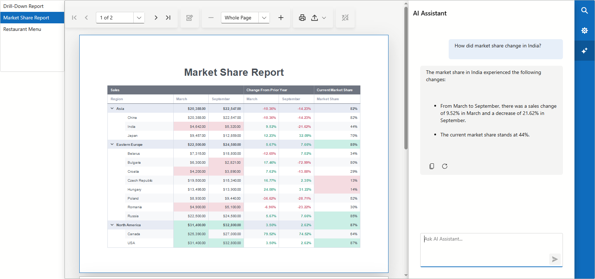

<!-- default badges list -->

[](https://supportcenter.devexpress.com/ticket/details/T1268742)
[](https://docs.devexpress.com/GeneralInformation/403183)
[](#does-this-example-address-your-development-requirementsobjectives)
<!-- default badges end -->
# Blazor Grid and Report Viewer — Add an AI Assistant (Azure OpenAI) to Your Next DevExpress-Powered Blazor App 

This sample app integrates AI-powered chat controls with DevExpress data-aware components.

The sample includes an application page with both a [DevExpress Blazor Grid](https://www.devexpress.com/blazor/data-grid/) component and the DevExpress Blazor AI Chat component ([`DxAIChat`](https://docs.devexpress.com/Blazor/DevExpress.AIIntegration.Blazor.Chat.DxAIChat)).



You can use the chat control to interrogate grid data. For example, you can ask the AI Assistant to do the following:

- Prioritize tasks.
- Count tasks by status.
- List tasks for a specific owner or with a specific priority.

The second sample page contains the [DevExpress Blazor Report Viewer](https://www.devexpress.com/subscriptions/reporting/) alongside our integrated AI Chat component. You can select one of three reports connected to different data sources:



You can ask the AI Assistant to do the following:

- *Drill-Down Report*: Analyze invoice totals, delivery status, and averages.
- *Market Share Report*: Compare market share changes across regions.
- *Restaurant Menu*: Examine price range and categorize vegetarian options.

AI agent initialization may take time (file upload and — on the Report Viewer page — document indexing). The app displays a loading message until the agent is ready.

## Implementation Details

### Register AI Services

> [!NOTE]  
> DevExpress AI-powered Extensions follow the "bring your own key" principle. DevExpress does not offer a REST API and does not ship any built-in LLMs/SLMs. You need an active Azure OpenAI subscription to obtain the REST API endpoint, key, and model deployment name. Specify these variables at application startup to register AI clients and enable DevExpress AI-powered Extensions in your application.

Reference the following NuGet packages:

- `DevExpress.AIIntegration.Blazor`
- `DevExpress.AIIntegration.Agents`
- `Azure.AI.OpenAI`
- `Microsoft.Agents.AI.OpenAI`
- `Microsoft.Extensions.AI.OpenAI`

> [!Note]
> We use the following versions of Microsoft AI packages in our `v26.1.3+` source code:
>
> * `Microsoft.Extensions.AI` | **v10.6.0**
> * `Microsoft.Extensions.AI.OpenAI` | **v10.6.0**
> * `Microsoft.Agents.AI.OpenAI` | **v1.5.0**
> * `Azure.AI.OpenAI` | **v2.9.0-beta.1**
>
> We cannot guarantee compatibility or correct operation with higher versions. Refer to the following announcement for additional information in this regard: [DevExpress.AIIntegration moves to a stable version](https://supportcenter.devexpress.com/ticket/details/t1292705/devexpress-aiintegration-references-stable-versions-of-microsoft-ai-packages).

Add the following code snippet to the `Program.cs` file to register AI services:

```cs
using Azure.AI.OpenAI;
using DevExpress.AI.Samples.Blazor.Services;
using DevExpress.AIIntegration;
using DevExpress.AIIntegration.Chat;
using Microsoft.Extensions.AI;
using System.ClientModel;
//...
string azureOpenAIEndpoint = "AZURE_OPENAI_ENDPOINT";
string azureOpenAIKey = "AZURE_OPENAI_API_KEY";
string deploymentName = "YOUR_MODEL_NAME";
//...
var azureOpenAIClient = new AzureOpenAIClient(
    new Uri(azureOpenAIEndpoint),
    new ApiKeyCredential(azureOpenAIKey));

var chatClient = azureOpenAIClient.GetChatClient(deploymentName).AsIChatClient();
builder.Services.AddChatClient(chatClient);
builder.Services.AddDevExpressAI();
builder.Services.AddSingleton(sp =>
    new AIAgentFactory(azureOpenAIClient, deploymentName, sp.GetRequiredService<ILogger<AIAgentFactory>>()));
builder.Services.AddSingleton<AIChatSessionStore>();
// Resolve an IChatResponseProvider for any key registered in AIChatSessionStore.
// DxAIChat components are bound to their providers using the ChatResponseProviderServiceKey property.
builder.Services.AddKeyedTransient<IChatResponseProvider>(KeyedService.AnyKey,
    (sp, key) => sp.GetRequiredService<AIChatSessionStore>().GetProvider(key as string));
```

The `AIAgentFactory` service creates AI agents to process exported component data. The factory wraps each agent in an `IChatResponseProvider` object. The `AIChatSessionStore` service stores these providers under unique keys. The keyed `IChatResponseProvider` registration allows each `DxAIChat` component to obtain its provider by key (using the [`ChatResponseProviderServiceKey`](https://docs.devexpress.com/Blazor/DevExpress.AIIntegration.Blazor.Chat.DxAIChat.ChatResponseProviderServiceKey) property).

Refer to the following help topic for additional information when connecting `DxAIChat` to external AI agents and assistants: [Chat with Your Own Data](https://docs.devexpress.com/Blazor/405974/ai-powered-extensions/ai-chat-component/ai-chat-with-own-data).

>[!NOTE]
> Azure OpenAI Responses API and tool availability depends on region and model. For additional information, refer to the following document: [Azure OpenAI Responses API](https://learn.microsoft.com/en-us/azure/ai-foundry/openai/how-to/responses).

**Files to Review:**

- [Program.cs](./CS/DevExpress.AI.Samples.Blazor/Program.cs)

### Create an AI Agent

The `AIAgentFactory.CreateAgentWithFileAsync` method performs the following operations:

1. Uploads a file to OpenAI.
2. Creates a short-lived vector store for the file if the File Search tool is enabled. Since Vector stores do not support XLSX files, the Grid page disables this tool.
3. Creates a Responses API agent with specified instructions, the Code Interpreter tool, and the optional File Search tool.
4. Starts an agent session that retains conversation history.
5. Returns an `IChatResponseProvider` object and a delegate that deletes the uploaded file and the vector store.

```cs
var tools = new List<AITool> {
    new HostedCodeInterpreterTool { Inputs = [new HostedFileContent(file.Id)] }
};
if(useFileSearchTool) {
    // ...
    tools.Add(new HostedFileSearchTool { Inputs = [new HostedVectorStoreContent(vectorStore.Id)] });
}

var aiAgent = responsesClient.AsAIAgent(
    instructions: instructions,
    tools: tools,
    name: $"Data Analysis Agent {Guid.NewGuid():N}",
    model: deployment);

var session = await aiAgent.CreateSessionAsync(ct);
return (aiAgent.AsIChatResponseProvider(session), Cleanup);
```

Refer to the following documents for additional information on the Responses API and AI agents: 
- [Azure OpenAI Responses API](https://learn.microsoft.com/en-us/azure/ai-foundry/openai/how-to/responses)
- [Microsoft Agent Framework](https://learn.microsoft.com/en-us/agent-framework/)
- [OpenAI .NET API library](https://github.com/openai/openai-dotnet)

Review the following file for Grid configuration details (data binding and customizations): [Instructions.cs](./CS/DevExpress.AI.Samples.Blazor/Instructions.cs).

**Files to Review:**

- [AIAgentFactory.cs](./CS/DevExpress.AI.Samples.Blazor/Services/AIAgentFactory.cs)
- [AIChatSessionStore.cs](./CS/DevExpress.AI.Samples.Blazor/Services/AIChatSessionStore.cs)
- [Instructions.cs](./CS/DevExpress.AI.Samples.Blazor/Instructions.cs)

### Use an AI Assistant with the DevExpress Blazor Grid

The Grid page contains the DevExpress Blazor Grid (`DxGrid`) and the AI Chat.

To configure the Grid component (data binding and customizations), review the following code file: [Grid.razor](./CS/DevExpress.AI.Samples.Blazor/Components/Pages/Grid.razor).

#### Add AI Chat to the Grid Page

The following code snippet adds the [`DxAIChat`](https://docs.devexpress.com/Blazor/DevExpress.AIIntegration.Blazor.Chat.DxAIChat) component to the page. The page displays the chat once the associated AI agent is ready (a loading message is displayed while waiting for the AI agent):

```razor
@using DevExpress.AIIntegration.Blazor.Chat
@using Markdig

<DxGrid @ref="grid" Data="@DataSource" CssClass="my-grid" ShowGroupPanel="true" TextWrapEnabled="false">
    @* ... *@
</DxGrid>
@if(chatProviderKey != null) {
    <DxAIChat CssClass="my-grid-chat" ChatResponseProviderServiceKey="@chatProviderKey">
        <MessageContentTemplate>
            <div class="my-chat-content">
                @ToHtml(context.Text)
            </div>
        </MessageContentTemplate>
    </DxAIChat>
} else {
    <div class="my-grid-chat my-chat-loading">Preparing the AI Assistant...</div>
}

@code {
    string chatProviderKey;
    MarkupString ToHtml(string text) {
        return (MarkupString)Markdown.ToHtml(text);
    }
}
```

Use the [`MessageContentTemplate`](https://docs.devexpress.com/Blazor/DevExpress.AIIntegration.Blazor.Chat.DxAIChat.MessageContentTemplate) property to display rich-formatted messages. Use a Markdown processor to convert response content to HTML.

**Files to Review:**

- [Grid.razor](./CS/DevExpress.AI.Samples.Blazor/Components/Pages/Grid.razor)

#### Set Up the AI Assistant for the Grid

Follow these steps to set up the AI Assistant for the Grid component:
- Override the `OnAfterRenderAsync` method and call the [`ExportToXlsxAsync`](https://docs.devexpress.com/Blazor/DevExpress.Blazor.DxGrid.ExportToXlsxAsync.overloads) method to generate data for the AI Assistant.
- Pass the data to the `AIAgentFactory.CreateAgentWithFileAsync` method, register the resulting provider in `AIChatSessionStore`, and assign the returned key to the `DxAIChat.ChatResponseProviderServiceKey` property.
- Close the session in `DisposeAsync` to delete the uploaded file when the user leaves the page.

```razor
@implements IAsyncDisposable
@inject AIAgentFactory AgentFactory
@inject AIChatSessionStore ChatSessionStore

@* ... *@
@code {
    protected override async Task OnAfterRenderAsync(bool firstRender) {
        if(firstRender) {
            using(MemoryStream ms = new MemoryStream()) {
                grid.BeginUpdate();
                grid.ShowGroupedColumns = true;
                await grid.ExportToXlsxAsync(ms, new GridXlExportOptions() {
                        ExportDisplayText = true
                    });
                grid.ShowGroupedColumns = false;
                grid.EndUpdate();

                // Vector stores do not support XLSX files, so the agent analyzes data with the Code Interpreter tool only.
                var (provider, cleanup) = await AgentFactory.CreateAgentWithFileAsync(
                    ms,
                    "grid_data.xlsx",
                    AssistantHelper.GetAIAssistantInstructions("xlsx"),
                    useFileSearchTool: false
                );
                chatProviderKey = ChatSessionStore.Register(provider, cleanup);
                StateHasChanged();
            }
        }
        await base.OnAfterRenderAsync(firstRender);
    }

    public async ValueTask DisposeAsync() {
        await ChatSessionStore.CloseAsync(chatProviderKey);
    }
}
```

**Files to Review:**

- [Grid.razor](./CS/DevExpress.AI.Samples.Blazor/Components/Pages/Grid.razor)

### Add an AI Assistant to the DevExpress Blazor Report Viewer

The Report Viewer page displays our Blazor Report Viewer alongside the DevExpress Chat component (the AI Assistant tab uses the `DxAIChat` component to display requests and responses).

#### Add a New Tab for Your AI Assistant

Use the [`OnCustomizeTabs`](https://docs.devexpress.com/XtraReports/DevExpress.Blazor.DxViewer.OnCustomizeTabs) event to add a new tab: 

```razor
@using DevExpress.AI.Samples.Blazor.Components.Reporting
@using DevExpress.AI.Samples.Blazor.Models
@using DevExpress.Blazor.Reporting.Models

@* ... *@
<DxReportViewer @ref="Viewer" CssClass="my-report" OnCustomizeTabs="OnCustomizeTabs">
</DxReportViewer>
@* ... *@

@code {
    // ...
    void OnCustomizeTabs(List<TabModel> tabs) {
        tabs.Add(new TabModel(new UserAssistantTabContentModel(() => CurrentReport), "AI", "AI Assistant") {
            TabTemplate = (tabModel) => {
                return (builder) => {
                    builder.OpenComponent<AITabRenderer>(0);
                    builder.AddComponentParameter(1, "Model", tabModel.ContentModel);
                    builder.CloseComponent();
                };
            }
        });
    }
}
```

The event handler adds a new [`TabModel`](https://docs.devexpress.com/XtraReports/DevExpress.Blazor.Reporting.Models.TabModel._members) object to the tab list. The [`UserAssistantTabContentModel`](./CS/DevExpress.AI.Samples.Blazor/Models/UserAssistantTabContentModel.cs) class implements the [`ITabContentModel`](https://docs.devexpress.com/XtraReports/DevExpress.Blazor.Reporting.Models.ITabContentModel) interface that specifies AI Assistant tab visibility. The tab appears only when the report is initialized and contains at least one page.

The `TabTemplate` property specifies tab content. This template renders the `AITabRenderer` component and passes `ContentModel` to it as a parameter.

**Files to Review:**

- [ReportViewer.razor](./CS/DevExpress.AI.Samples.Blazor/Components/Pages/ReportViewer.razor)
- [UserAssistantTabContentModel.cs](./CS/DevExpress.AI.Samples.Blazor/Models/UserAssistantTabContentModel.cs)

#### Set Up the AI Assistant for the Report Viewer

The following file defines AI Assistant tab content: [AITabRenderer.razor](./CS/DevExpress.AI.Samples.Blazor/Components/Reporting/AITabRenderer.razor).

Follow the steps below to set up the AI Assistant for the Report Viewer:
- Override the `OnInitializedAsync` method and call the [`ExportToPdf`](https://docs.devexpress.com/CoreLibraries/DevExpress.XtraPrinting.PrintingSystemBase.ExportToPdf(System.IO.Stream)) method to generate data for the AI Assistant.
- Pass the data to the `AIAgentFactory.CreateAgentWithFileAsync` method. The agent uses both File Search and Code Interpreter tools to analyze the PDF document.
- Register the resulting provider in `AIChatSessionStore` and assign the returned key to the `DxAIChat.ChatResponseProviderServiceKey` property.

```razor
@using DevExpress.AI.Samples.Blazor.Models
@using DevExpress.AI.Samples.Blazor.Services
@using DevExpress.AIIntegration.Blazor.Chat
@using System.Text.RegularExpressions
@using Markdig

@implements IAsyncDisposable
@inject AIAgentFactory AgentFactory
@inject AIChatSessionStore ChatSessionStore

@if(chatProviderKey != null) {
    <DxAIChat CssClass="my-report-chat" ChatResponseProviderServiceKey="@chatProviderKey">
        <MessageContentTemplate>
            <div class="my-chat-content">
                @ToHtml(context.Text)
            </div>
        </MessageContentTemplate>
    </DxAIChat>
} else {
    <div class="my-report-chat my-chat-loading">Preparing the AI Assistant...</div>
}

@code {
    string chatProviderKey;
    [Parameter] public UserAssistantTabContentModel Model { get; set; }
    string ClearAnnotations(string text) {
        //To clear out annotations in a response from the assistant.
        return Regex.Replace(text, @"\【.*?】", "");
    }

    MarkupString ToHtml(string text) {
        text = ClearAnnotations(text);
        return (MarkupString)Markdown.ToHtml(text);
    }

    protected override async Task OnInitializedAsync() {
        using (MemoryStream ms = Model.GetReportData()) {
            var (provider, cleanup) = await AgentFactory.CreateAgentWithFileAsync(
                ms,
                "report.pdf",
                AssistantHelper.GetAIAssistantInstructions("pdf")
            );
            chatProviderKey = ChatSessionStore.Register(provider, cleanup);
        }
    }

    public async ValueTask DisposeAsync() {
        await ChatSessionStore.CloseAsync(chatProviderKey);
    }
}
```

Use the [`MessageContentTemplate`](https://docs.devexpress.com/Blazor/DevExpress.AIIntegration.Blazor.Chat.DxAIChat.MessageContentTemplate) property to display rich-formatted messages. Use a markdown processor to convert response content to HTML.

**Files to Review:**

- [AITabRenderer.razor](./CS/DevExpress.AI.Samples.Blazor/Components/Reporting/AITabRenderer.razor)
- [AIAgentFactory.cs](./CS/DevExpress.AI.Samples.Blazor/Services/AIAgentFactory.cs)
- [Instructions.cs](./CS/DevExpress.AI.Samples.Blazor/Instructions.cs)

## Files to Review

- [Program.cs](./CS/DevExpress.AI.Samples.Blazor/Program.cs)
- [AIAgentFactory.cs](./CS/DevExpress.AI.Samples.Blazor/Services/AIAgentFactory.cs)
- [AIChatSessionStore.cs](./CS/DevExpress.AI.Samples.Blazor/Services/AIChatSessionStore.cs)
- [Instructions.cs](./CS/DevExpress.AI.Samples.Blazor/Instructions.cs)
- [Grid.razor](./CS/DevExpress.AI.Samples.Blazor/Components/Pages/Grid.razor)
- [ReportViewer.razor](./CS/DevExpress.AI.Samples.Blazor/Components/Pages/ReportViewer.razor)
- [AITabRenderer.razor](./CS/DevExpress.AI.Samples.Blazor/Components/Reporting/AITabRenderer.razor)
- [UserAssistantTabContentModel.cs](./CS/DevExpress.AI.Samples.Blazor/Models/UserAssistantTabContentModel.cs)

## Documentation

- [Blazor AI Chat](https://docs.devexpress.com/Blazor/DevExpress.AIIntegration.Blazor.Chat.DxAIChat)
- [Blazor AI Chat — Chat with Your Own Data](https://docs.devexpress.com/Blazor/405974/ai-powered-extensions/ai-chat-component/ai-chat-with-own-data)
- [Demo: Blazor AI Chat](https://demos.devexpress.com/blazor/AI/Chat#Overview)
- [Blazor Grid](https://docs.devexpress.com/Blazor/403143/components/grid)
- [Blazor Report Viewer](https://docs.devexpress.com/XtraReports/403594/web-reporting/blazor-reporting/server/blazor-report-viewer-native)
- [AI-powered Extensions for DevExpress Reporting](https://docs.devexpress.com/XtraReports/405211/ai-powered-functionality/ai-for-devexpress-reporting)

## More Examples

- [Reports for Blazor - Integrate AI-powered Summarize and Translate Features based on Azure OpenAI](https://github.com/DevExpress-Examples/blazor-reporting-ai/)
- [Reports for ASP.NET Core - Integrate AI Assistant based on Azure OpenAI](https://github.com/DevExpress-Examples/web-reporting-integrate-ai-assistant)
- [AI Chat for Blazor - How to add DxAIChat component in Blazor, MAUI, WPF, and WinForms applications](https://github.com/DevExpress-Examples/devexpress-ai-chat-samples)
- [Rich Text Editor and HTML Editor for Blazor - How to integrate AI-powered extensions](https://github.com/DevExpress-Examples/blazor-ai-integration-to-text-editors)
<!-- feedback -->
## Does This Example Address Your Development Requirements/Objectives?

[](https://www.devexpress.com/support/examples/survey.xml?utm_source=github&utm_campaign=blazor-grid-and-report-viewer-integrate-ai-assistant&~~~was_helpful=yes) [](https://www.devexpress.com/support/examples/survey.xml?utm_source=github&utm_campaign=blazor-grid-and-report-viewer-integrate-ai-assistant&~~~was_helpful=no)

(you will be redirected to DevExpress.com to submit your response)
<!-- feedback end -->
